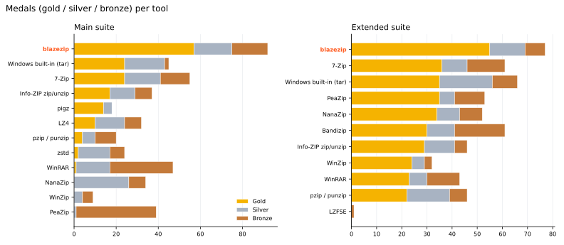
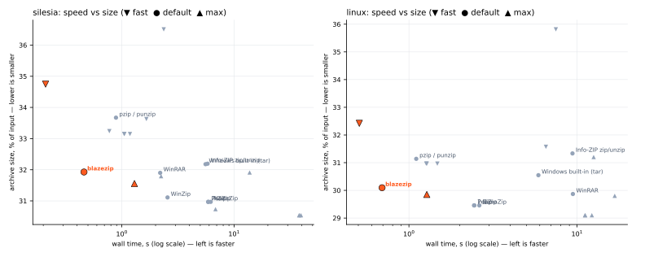
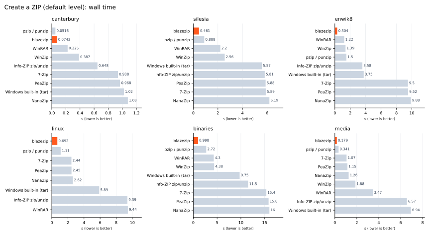
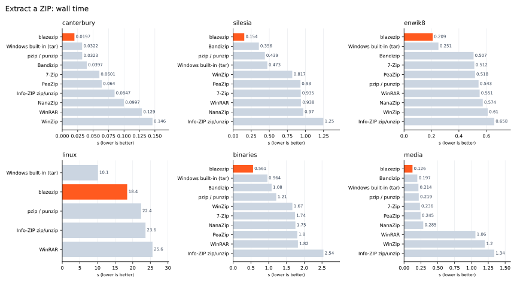
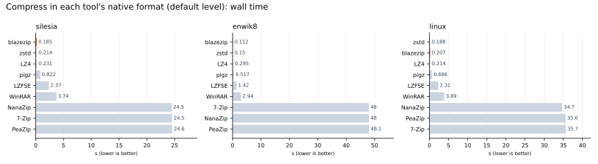
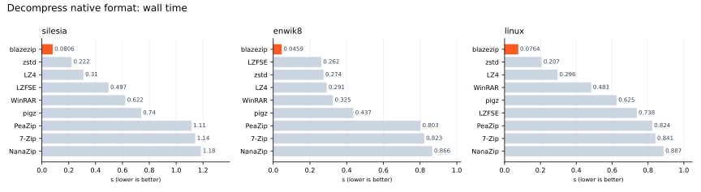
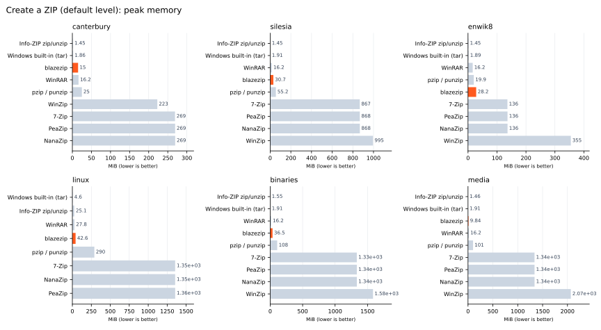

# blazezip

[](https://github.com/marksmayo/blazezip/actions/workflows/ci.yml)
[](LICENSE)

A very fast, parallel, standards-compliant ZIP archiver for Windows, plus a benchmark suite that
pits it against 7-Zip, NanaZip, PeaZip, Bandizip, WinRAR, WinZip, Info-ZIP, pzip, zstd, pigz, LZ4
and LZFSE and awards medals. On the test machine it wins more gold medals than any other tool in
both suites; see [Performance](#performance).

blazezip is Windows-only: it uses Windows file APIs directly for its speed.

## Installing

Download `blazezip-<version>-x86_64-pc-windows-msvc.zip` from
[Releases](https://github.com/marksmayo/blazezip/releases), unzip it and put `blazezip.exe` on your
`PATH`. Each release has a `.sha256` checksum next to it.

To build from source you need Rust (stable, MSVC toolchain). LLVM's `clang-cl` is optional but
recommended: with it, libdeflate gets its fastest (BMI2) decoder.

```
cargo build --release        # target/release/blazezip.exe
cargo test --release
```

## Using blazezip

```
blazezip c out.zip folder [more inputs...]   # create (Deflate, level 6)
blazezip c out.zip folder -1                 # fastest   (-12 = smallest)
blazezip c out.zip folder --zstd             # Zstandard inside ZIP (method 93)
blazezip a out.zip more-files                # add (replacing same-named entries)
blazezip d out.zip folder/old.txt            # delete entries (or whole directories)
blazezip x out.zip -o dest                   # extract
blazezip x out.zip folder/a.txt -o dest      # extract only the named entries
blazezip t out.zip                           # verify CRCs without writing
blazezip l out.zip                           # list
```

Options: `-t N` threads (default: 8 when creating Deflate archives, up to 12 for small inputs at
`-7` and above; otherwise all logical CPUs), `--chunk MiB`, `--no-store`, `-q`, `-V`/`--version`.
The thread count never changes the archive: the same inputs and options give the same bytes.

Exit codes: `0` on success, `1` on any error. `1` is also returned when the job finished but not
cleanly: input files that could not be read were left out of the archive (and named on stderr), or a
damaged archive was only partly recovered.

## Why it's fast

- **Everything is parallel.** Files compress concurrently (runs of small files are batched into
  one job); a single large file is split into 1 MiB chunks that compress on all cores. The input
  tree is walked in parallel. A bounded in-flight window (in jobs and bytes) keeps memory
  proportional to the thread count rather than the input size, and output buffers are recycled.
- **libdeflate** does all Deflate work. It is vendored in `third_party/libdeflate` with one small
  addition, `libdeflate_deflate_compress_sync()`, which ends a chunk with a sync flush instead of
  a final block. The chunks concatenate into one ordinary Deflate stream that every unzip tool
  reads. With LLVM installed, libdeflate is built with clang-cl, which (unlike MSVC) can build
  its BMI2 decompressor and fastest CRC-32; blazezip uses that CRC-32 too.
- **Parallel decompression of single large files.** blazezip records each chunk's compressed
  size in a private extra field (`0x7a42`) that other tools ignore. On extraction, every chunk
  is decoded independently, straight into a memory-mapped output file.
- **Incompressible data is detected and stored.** Samples are test-compressed first, so photos,
  video and existing archives skip pointless work.
- **Only the threads that help.** Storing incompressible data is I/O-bound, so creation uses
  two threads plus one per MiB that actually needs compressing. Extraction stops adding threads
  once the largest file, not the thread count, sets the finishing time.
- **Windows-aware I/O.** Directories are created up front (a level at a time, in parallel),
  files are created from many threads (NTFS file creation parallelises well; for many small
  files, twice as many threads as cores), handles are closed on separate threads because closing
  a freshly written file is where antivirus scanning blocks, and large stored entries are
  streamed with `ReadFile` and `WriteFile` instead of page-faulting a mapping. The process opts
  out of Windows power throttling so it isn't parked on efficiency cores.

Archives are plain ZIP (Zip64 when needed), verified with `7z t` and Info-ZIP `unzip -t`. They
record Windows attributes (read-only, hidden, system) and NTFS timestamps (100 ns), which
blazezip and 7-Zip restore on extraction. A file that cannot be read (locked by another process,
say) is skipped with a warning and a non-zero exit code; everything else is archived. An
interrupted or failed run never leaves a partial archive behind. Adding and deleting copy the
other entries' compressed data unchanged, and if an archive's central directory is missing
(a truncated download, say), extraction recovers what the local headers still describe and
exits with an error.

<!-- perf:start -->

## Performance

_Measured on 12th Gen Intel(R) Core(TM) i7-12700H (14 cores, 20 threads), 31.7 GB RAM, NVMe KXG70ZNV512G NVMe KIOXIA 512GB, Windows 11 (10.0.26300), with Windows Defender real-time protection on. Every test runs 10 times under a Windows Job Object; the median of the fastest five runs is reported. Competitors keep their best result across recent runs, blazezip shows its latest. Tool versions are listed below. Generated by `python bench/readme_perf.py` on 2026-10-14._



### Main suite: medal table

Every benchmark awards gold, silver and bronze for each metric: wall time, CPU time, peak memory and (when creating) archive size.

| # | Tool | 🥇 | 🥈 | 🥉 | Total |
|--:|---|--:|--:|--:|--:|
| 1 | **blazezip** | 57 | 18 | 17 | 92 |
| 2 | Windows built-in (tar) | 24 | 19 | 2 | 45 |
| 3 | 7-Zip | 24 | 17 | 14 | 55 |
| 4 | Info-ZIP zip/unzip | 17 | 12 | 8 | 37 |
| 5 | pigz | 14 | 4 | 0 | 18 |
| 6 | LZ4 | 10 | 14 | 8 | 32 |
| 7 | pzip / punzip | 4 | 6 | 10 | 20 |
| 8 | zstd | 2 | 15 | 7 | 24 |
| 9 | WinRAR | 1 | 16 | 30 | 47 |
| 10 | NanaZip | 0 | 26 | 8 | 34 |
| 11 | WinZip | 0 | 4 | 5 | 9 |
| 12 | PeaZip | 0 | 1 | 38 | 39 |
| 13 | LZFSE | 0 | 1 | 6 | 7 |

### Where blazezip wins

Gold medals won by blazezip, by metric: **Speed (wall) 34/42**, **CPU time 16/42**, **Peak memory 4/42**, **Size 3/27**.

Each cell is blazezip's result and its place; where it is not in the top three, the best tool's result is shown for comparison. Sizes are the archive as a share of the input.

| Benchmark | Speed (wall) | CPU time | Peak memory | Size |
|---|---|---|---|---|
| Create a ZIP · canterbury · fast | 🥇 0.024 s | 🥇 0.125 s | 🥈 11.2 MiB | 6th · 32.2% (best 7-Zip 30.4%) |
| Create a ZIP · canterbury · default | 🥈 0.0743 s | 🥈 0.469 s | 🥉 15.0 MiB | 5th · 28.5% (best 7-Zip 27.3%) |
| Create a ZIP · canterbury · max | 🥇 0.248 s | 🥈 2.67 s | 🥉 22.3 MiB | 5th · 28.1% (best 7-Zip 27.3%) |
| Create a ZIP · silesia · fast | 🥇 0.21 s | 🥇 1.56 s | 🥉 26.6 MiB | 6th · 34.7% (best 7-Zip 33.1%) |
| Create a ZIP · silesia · default | 🥇 0.461 s | 🥇 3.53 s | 4th · 30.7 MiB (best Info-ZIP zip/unzip 1.5 MiB) | 6th · 31.9% (best 7-Zip 31.0%) |
| Create a ZIP · silesia · max | 🥇 1.3 s | 🥇 10 s | 🥉 31.6 MiB | 5th · 31.6% (best 7-Zip 30.5%) |
| Create a ZIP · enwik8 · fast | 🥇 0.132 s | 🥇 0.922 s | 🥉 24.6 MiB | 6th · 39.2% (best 7-Zip 37.9%) |
| Create a ZIP · enwik8 · default | 🥇 0.304 s | 🥈 2.22 s | 5th · 28.2 MiB (best Info-ZIP zip/unzip 1.4 MiB) | 8th · 36.7% (best 7-Zip 35.2%) |
| Create a ZIP · enwik8 · max | 🥇 0.528 s | 🥇 4.06 s | 🥉 28.2 MiB | 6th · 36.3% (best 7-Zip 35.1%) |
| Create a ZIP · linux · fast | 🥇 0.507 s | 🥇 3.69 s | 🥉 37.6 MiB | 5th · 32.4% (best 7-Zip 31.0%) |
| Create a ZIP · linux · default | 🥇 0.692 s | 🥇 5.28 s | 4th · 42.6 MiB (best Windows built-in (tar) 4.6 MiB) | 5th · 30.1% (best 7-Zip 29.5%) |
| Create a ZIP · linux · max | 🥇 1.28 s | 🥇 9.61 s | 🥉 49.7 MiB | 5th · 29.9% (best 7-Zip 29.1%) |
| Create a ZIP · binaries · fast | 🥇 0.544 s | 🥇 4.08 s | 🥉 34.0 MiB | 6th · 33.4% (best 7-Zip 31.6%) |
| Create a ZIP · binaries · default | 🥇 0.998 s | 🥈 7.67 s | 4th · 36.5 MiB (best Info-ZIP zip/unzip 1.6 MiB) | 6th · 30.7% (best 7-Zip 29.9%) |
| Create a ZIP · binaries · max | 🥇 2.54 s | 🥇 19.1 s | 🥉 37.1 MiB | 5th · 30.5% (best 7-Zip 29.5%) |
| Create a ZIP · media · fast | 🥇 0.187 s | 🥇 0.453 s | 🥈 9.6 MiB | 🥇 100.0% |
| Create a ZIP · media · default | 🥇 0.179 s | 🥇 0.359 s | 🥉 9.8 MiB | 🥇 100.0% |
| Create a ZIP · media · max | 🥇 0.18 s | 🥇 0.391 s | 🥈 9.7 MiB | 🥇 100.0% |
| Extract a ZIP · canterbury | 🥇 0.019 s | 🥈 0.0312 s | 7th · 11.4 MiB (best Windows built-in (tar) 1.4 MiB) |  |
| Extract a ZIP · silesia | 🥇 0.14 s | 🥈 0.516 s | 8th · 20.4 MiB (best Windows built-in (tar) 1.4 MiB) |  |
| Extract a ZIP · enwik8 | 🥇 0.198 s | 🥇 0.188 s | 🥇 0.9 MiB |  |
| Extract a ZIP · linux | 🥈 20.6 s | 🥈 22.1 s | 4th · 26.5 MiB (best Windows built-in (tar) 5.5 MiB) |  |
| Extract a ZIP · binaries | 🥇 0.62 s | 🥈 1.23 s | 7th · 19.6 MiB (best Windows built-in (tar) 1.5 MiB) |  |
| Extract a ZIP · media | 🥇 0.125 s | 5th · 0.281 s (best Windows built-in (tar) 0.188 s) | 8th · 22.2 MiB (best Windows built-in (tar) 1.1 MiB) |  |
| Extract the tool's own ZIP · canterbury | 🥇 0.0176 s | 🥇 0.0156 s | 6th · 6.7 MiB (best Windows built-in (tar) 1.4 MiB) |  |
| Extract the tool's own ZIP · silesia | 🥇 0.0895 s | 6th · 0.984 s (best Windows built-in (tar) 0.391 s) | 8th · 24.3 MiB (best Windows built-in (tar) 1.4 MiB) |  |
| Extract the tool's own ZIP · enwik8 | 🥇 0.046 s | 🥈 0.5 s | 9th · 18.8 MiB (best Windows built-in (tar) 1.4 MiB) |  |
| Extract the tool's own ZIP · linux | 🥈 20.1 s | 🥈 22.5 s | 4th · 26.5 MiB (best Windows built-in (tar) 5.5 MiB) |  |
| Extract the tool's own ZIP · binaries | 🥇 0.207 s | 6th · 1.92 s (best Windows built-in (tar) 0.781 s) | 8th · 24.8 MiB (best Windows built-in (tar) 1.5 MiB) |  |
| Extract the tool's own ZIP · media | 🥇 0.137 s | 5th · 0.281 s (best Windows built-in (tar) 0.203 s) | 8th · 22.2 MiB (best Windows built-in (tar) 1.4 MiB) |  |
| Compress, native format · silesia · fast | 🥇 0.103 s | 🥉 1.27 s | 6th · 158.9 MiB (best pigz 25.1 MiB) | 6th · 34.6% (best 7-Zip 27.9%) |
| Compress, native format · silesia · default | 🥇 0.185 s | 4th · 2.47 s (best LZ4 0.656 s) | 🥉 165.5 MiB | 6th · 31.4% (best 7-Zip 23.4%) |
| Compress, native format · silesia · max | 4th · 7.97 s (best pigz 1.76 s) | 8th · 127 s (best pigz 31.7 s) | 4th · 1124.5 MiB (best pigz 25.1 MiB) | 6th · 26.2% (best 7-Zip 23.0%) |
| Compress, native format · enwik8 · fast | 🥇 0.0724 s | 🥉 0.812 s | 4th · 87.8 MiB (best pigz 25.1 MiB) | 6th · 40.8% (best 7-Zip 33.4%) |
| Compress, native format · enwik8 · default | 🥇 0.112 s | 4th · 1.53 s (best LZ4 0.391 s) | 🥉 99.2 MiB | 6th · 35.9% (best 7-Zip 25.4%) |
| Compress, native format · enwik8 · max | 4th · 4.35 s (best pigz 0.613 s) | 4th · 62.5 s (best LZ4 10.7 s) | 4th · 738.5 MiB (best pigz 24.9 MiB) | 6th · 30.6% (best 7-Zip 24.8%) |
| Compress, native format · linux · fast | 🥈 0.14 s | 🥉 1.73 s | 6th · 149.9 MiB (best pigz 25.1 MiB) | 6th · 24.9% (best 7-Zip 20.0%) |
| Compress, native format · linux · default | 🥈 0.207 s | 4th · 3 s (best LZ4 0.703 s) | 🥉 160.9 MiB | 8th · 22.4% (best 7-Zip 16.0%) |
| Compress, native format · linux · max | 4th · 7.73 s (best pigz 1.25 s) | 7th · 126 s (best pigz 20.6 s) | 4th · 1117.3 MiB (best pigz 25.1 MiB) | 6th · 17.5% (best 7-Zip 15.3%) |
| Decompress, native format · silesia | 🥇 0.0884 s | 4th · 0.891 s (best LZ4 0.188 s) | 🥇 3.8 MiB |  |
| Decompress, native format · enwik8 | 🥇 0.0569 s | 5th · 0.531 s (best LZ4 0.0938 s) | 🥇 3.6 MiB |  |
| Decompress, native format · linux | 🥇 0.0887 s | 4th · 0.859 s (best LZ4 0.172 s) | 🥇 3.8 MiB |  |

<details><summary><b>Every tool, every benchmark (full main-suite results)</b></summary>

**Create a ZIP · canterbury · fast**

| Tool | Speed (wall) | CPU time | Peak memory | Size |
|---|--:|--:|--:|--:|
| **blazezip** | 🥇 0.024 s | 🥇 0.125 s | 🥈 11.2 MiB | 32.2% |
| Info-ZIP zip/unzip | 🥈 0.138 s | 🥈 0.141 s | 🥇 1.4 MiB | 35.3% |
| WinRAR | 🥉 0.168 s | 🥉 0.25 s | 🥉 16.2 MiB | 31.0% |
| WinZip | 0.185 s | 0.703 s | 218.7 MiB | 30.6% |
| 7-Zip | 0.191 s | 0.312 s | 268.6 MiB | 🥇 30.4% |
| PeaZip | 0.197 s | 0.312 s | 268.9 MiB | 🥉 30.4% |
| NanaZip | 0.271 s | 0.344 s | 269.0 MiB | 🥈 30.4% |

**Create a ZIP · canterbury · default**

| Tool | Speed (wall) | CPU time | Peak memory | Size |
|---|--:|--:|--:|--:|
| pzip / punzip | 🥇 0.0516 s | 🥇 0.109 s | 25.0 MiB | 30.3% |
| **blazezip** | 🥈 0.0743 s | 🥈 0.469 s | 🥉 15.0 MiB | 28.5% |
| WinRAR | 🥉 0.225 s | 0.781 s | 16.2 MiB | 29.2% |
| WinZip | 0.387 s | 3.67 s | 222.6 MiB | 27.9% |
| Info-ZIP zip/unzip | 0.648 s | 🥉 0.641 s | 🥇 1.5 MiB | 29.2% |
| 7-Zip | 0.938 s | 1.78 s | 268.9 MiB | 🥇 27.3% |
| PeaZip | 0.968 s | 1.83 s | 269.2 MiB | 🥉 27.3% |
| Windows built-in (tar) | 1.02 s | 1.02 s | 🥈 1.9 MiB | 29.2% |
| NanaZip | 1.08 s | 1.83 s | 269.4 MiB | 🥈 27.3% |

**Create a ZIP · canterbury · max**

| Tool | Speed (wall) | CPU time | Peak memory | Size |
|---|--:|--:|--:|--:|
| **blazezip** | 🥇 0.248 s | 🥈 2.67 s | 🥉 22.3 MiB | 28.1% |
| WinRAR | 🥈 0.27 s | 🥇 1.55 s | 🥈 16.2 MiB | 28.8% |
| WinZip | 🥉 0.696 s | 9.08 s | 260.3 MiB | 27.6% |
| Info-ZIP zip/unzip | 2.82 s | 🥉 2.77 s | 🥇 1.4 MiB | 28.7% |
| PeaZip | 4.53 s | 9.62 s | 273.0 MiB | 🥉 27.3% |
| 7-Zip | 4.66 s | 9.86 s | 272.7 MiB | 🥇 27.3% |
| NanaZip | 4.75 s | 10 s | 273.1 MiB | 🥈 27.3% |

**Create a ZIP · silesia · fast**

| Tool | Speed (wall) | CPU time | Peak memory | Size |
|---|--:|--:|--:|--:|
| **blazezip** | 🥇 0.21 s | 🥇 1.56 s | 🥉 26.6 MiB | 34.7% |
| WinZip | 🥈 0.775 s | 8.78 s | 985.8 MiB | 33.2% |
| 7-Zip | 🥉 1.05 s | 5.23 s | 865.7 MiB | 🥇 33.1% |
| PeaZip | 1.06 s | 5.17 s | 866.0 MiB | 🥉 33.1% |
| NanaZip | 1.18 s | 5.3 s | 866.3 MiB | 🥈 33.1% |
| WinRAR | 1.66 s | 🥉 3.52 s | 🥈 16.2 MiB | 33.6% |
| Info-ZIP zip/unzip | 2.37 s | 🥈 2.34 s | 🥇 1.5 MiB | 36.5% |

**Create a ZIP · silesia · default**

| Tool | Speed (wall) | CPU time | Peak memory | Size |
|---|--:|--:|--:|--:|
| **blazezip** | 🥇 0.461 s | 🥇 3.53 s | 30.7 MiB | 31.9% |
| pzip / punzip | 🥈 0.888 s | 🥈 3.72 s | 55.2 MiB | 33.7% |
| WinRAR | 🥉 2.2 s | 9.7 s | 🥉 16.2 MiB | 31.9% |
| WinZip | 2.56 s | 42.3 s | 995.2 MiB | 31.1% |
| Windows built-in (tar) | 5.57 s | 🥉 5.52 s | 🥈 1.9 MiB | 32.2% |
| Info-ZIP zip/unzip | 5.81 s | 5.72 s | 🥇 1.5 MiB | 32.2% |
| PeaZip | 5.88 s | 26.5 s | 867.5 MiB | 🥉 31.0% |
| 7-Zip | 5.89 s | 26.8 s | 867.2 MiB | 🥇 31.0% |
| NanaZip | 6.19 s | 27.9 s | 867.8 MiB | 🥈 31.0% |

**Create a ZIP · silesia · max**

| Tool | Speed (wall) | CPU time | Peak memory | Size |
|---|--:|--:|--:|--:|
| **blazezip** | 🥇 1.3 s | 🥇 10 s | 🥉 31.6 MiB | 31.6% |
| WinRAR | 🥈 2.24 s | 🥈 11.1 s | 🥈 16.2 MiB | 31.8% |
| WinZip | 🥉 6.83 s | 120 s | 1276.2 MiB | 30.7% |
| Info-ZIP zip/unzip | 13.8 s | 🥉 13.6 s | 🥇 1.5 MiB | 31.9% |
| 7-Zip | 37.9 s | 172 s | 882.2 MiB | 🥇 30.5% |
| PeaZip | 38.2 s | 174 s | 882.6 MiB | 🥉 30.5% |
| NanaZip | 39.4 s | 181 s | 882.9 MiB | 🥈 30.5% |

**Create a ZIP · enwik8 · fast**

| Tool | Speed (wall) | CPU time | Peak memory | Size |
|---|--:|--:|--:|--:|
| **blazezip** | 🥇 0.132 s | 🥇 0.922 s | 🥉 24.6 MiB | 39.2% |
| WinZip | 🥈 0.498 s | 5.02 s | 352.4 MiB | 37.9% |
| WinRAR | 🥉 0.917 s | 2.09 s | 🥈 16.2 MiB | 38.2% |
| Info-ZIP zip/unzip | 1.24 s | 🥈 1.23 s | 🥇 1.4 MiB | 42.3% |
| PeaZip | 2.03 s | 🥉 2 s | 136.1 MiB | 🥉 37.9% |
| 7-Zip | 2.04 s | 2.03 s | 135.9 MiB | 🥇 37.9% |
| NanaZip | 2.22 s | 2.11 s | 136.3 MiB | 🥈 37.9% |

**Create a ZIP · enwik8 · default**

| Tool | Speed (wall) | CPU time | Peak memory | Size |
|---|--:|--:|--:|--:|
| **blazezip** | 🥇 0.304 s | 🥈 2.22 s | 28.2 MiB | 36.7% |
| WinRAR | 🥈 1.22 s | 4.83 s | 🥉 16.2 MiB | 36.3% |
| WinZip | 🥉 1.39 s | 21.8 s | 354.9 MiB | 35.2% |
| pzip / punzip | 1.5 s | 🥇 1.44 s | 19.9 MiB | 37.8% |
| Info-ZIP zip/unzip | 3.58 s | 🥉 3.55 s | 🥇 1.4 MiB | 36.5% |
| Windows built-in (tar) | 3.75 s | 3.7 s | 🥈 1.9 MiB | 36.5% |
| 7-Zip | 9.5 s | 9.36 s | 136.0 MiB | 🥇 35.2% |
| PeaZip | 9.52 s | 9.42 s | 136.3 MiB | 🥉 35.2% |
| NanaZip | 9.88 s | 9.59 s | 136.4 MiB | 🥈 35.2% |

**Create a ZIP · enwik8 · max**

| Tool | Speed (wall) | CPU time | Peak memory | Size |
|---|--:|--:|--:|--:|
| **blazezip** | 🥇 0.528 s | 🥇 4.06 s | 🥉 28.2 MiB | 36.3% |
| WinRAR | 🥈 1.25 s | 🥉 5.77 s | 🥈 16.2 MiB | 36.2% |
| WinZip | 🥉 3.53 s | 60.4 s | 380.0 MiB | 35.1% |
| Info-ZIP zip/unzip | 4.54 s | 🥈 4.48 s | 🥇 1.4 MiB | 36.4% |
| 7-Zip | 58 s | 57.2 s | 137.3 MiB | 🥇 35.1% |
| PeaZip | 58 s | 57.3 s | 137.5 MiB | 🥉 35.1% |
| NanaZip | 59.4 s | 58.3 s | 137.7 MiB | 🥈 35.1% |

**Create a ZIP · linux · fast**

| Tool | Speed (wall) | CPU time | Peak memory | Size |
|---|--:|--:|--:|--:|
| **blazezip** | 🥇 0.507 s | 🥇 3.69 s | 🥉 37.6 MiB | 32.4% |
| 7-Zip | 🥈 1.27 s | 🥈 7.11 s | 1352.4 MiB | 🥇 31.0% |
| PeaZip | 🥉 1.28 s | 🥉 7.22 s | 1352.7 MiB | 🥉 31.0% |
| NanaZip | 1.48 s | 7.5 s | 1352.4 MiB | 🥈 31.0% |
| WinRAR | 6.53 s | 8.61 s | 🥈 27.8 MiB | 31.6% |
| Info-ZIP zip/unzip | 7.48 s | 7.42 s | 🥇 25.0 MiB | 35.8% |

**Create a ZIP · linux · default**

| Tool | Speed (wall) | CPU time | Peak memory | Size |
|---|--:|--:|--:|--:|
| **blazezip** | 🥇 0.692 s | 🥇 5.28 s | 42.6 MiB | 30.1% |
| pzip / punzip | 🥈 1.11 s | 🥉 8.52 s | 290.0 MiB | 31.1% |
| 7-Zip | 🥉 2.44 s | 33.7 s | 1354.8 MiB | 🥇 29.5% |
| PeaZip | 2.45 s | 34.1 s | 1355.3 MiB | 🥉 29.5% |
| NanaZip | 2.62 s | 34.5 s | 1354.9 MiB | 🥈 29.5% |
| Windows built-in (tar) | 5.89 s | 🥈 5.83 s | 🥇 4.6 MiB | 30.5% |
| Info-ZIP zip/unzip | 9.39 s | 9.33 s | 🥈 25.1 MiB | 31.3% |
| WinRAR | 9.44 s | 15.5 s | 🥉 27.8 MiB | 29.9% |

**Create a ZIP · linux · max**

| Tool | Speed (wall) | CPU time | Peak memory | Size |
|---|--:|--:|--:|--:|
| **blazezip** | 🥇 1.28 s | 🥇 9.61 s | 🥉 49.7 MiB | 29.9% |
| PeaZip | 🥈 11.1 s | 202 s | 1380.2 MiB | 🥉 29.1% |
| 7-Zip | 🥉 11.2 s | 205 s | 1379.9 MiB | 🥇 29.1% |
| NanaZip | 12.2 s | 223 s | 1379.4 MiB | 🥈 29.1% |
| Info-ZIP zip/unzip | 12.6 s | 🥈 12.4 s | 🥇 25.0 MiB | 31.2% |
| WinRAR | 16.7 s | 🥉 22.7 s | 🥈 27.9 MiB | 29.8% |

**Create a ZIP · binaries · fast**

| Tool | Speed (wall) | CPU time | Peak memory | Size |
|---|--:|--:|--:|--:|
| **blazezip** | 🥇 0.544 s | 🥇 4.08 s | 🥉 34.0 MiB | 33.4% |
| WinZip | 🥈 1.47 s | 14.4 s | 1512.6 MiB | 31.8% |
| 7-Zip | 🥉 3.02 s | 7.98 s | 1332.4 MiB | 🥇 31.6% |
| PeaZip | 3.04 s | 8.11 s | 1332.8 MiB | 🥉 31.6% |
| NanaZip | 3.26 s | 8.36 s | 1333.2 MiB | 🥈 31.6% |
| WinRAR | 3.38 s | 🥉 7.77 s | 🥈 16.2 MiB | 32.0% |
| Info-ZIP zip/unzip | 4.75 s | 🥈 4.67 s | 🥇 1.5 MiB | 34.9% |

**Create a ZIP · binaries · default**

| Tool | Speed (wall) | CPU time | Peak memory | Size |
|---|--:|--:|--:|--:|
| **blazezip** | 🥇 0.998 s | 🥈 7.67 s | 36.5 MiB | 30.7% |
| pzip / punzip | 🥈 2.72 s | 🥇 6.44 s | 108.0 MiB | 32.7% |
| WinRAR | 🥉 4.3 s | 19.9 s | 🥉 16.2 MiB | 30.6% |
| WinZip | 4.38 s | 69.4 s | 1584.5 MiB | 30.1% |
| Windows built-in (tar) | 9.75 s | 🥉 9.66 s | 🥈 1.9 MiB | 30.8% |
| Info-ZIP zip/unzip | 11.5 s | 11.3 s | 🥇 1.6 MiB | 30.8% |
| 7-Zip | 15.4 s | 42.9 s | 1334.8 MiB | 🥇 29.9% |
| PeaZip | 15.8 s | 43.2 s | 1335.2 MiB | 🥉 29.9% |
| NanaZip | 16 s | 44.1 s | 1335.7 MiB | 🥈 29.9% |

**Create a ZIP · binaries · max**

| Tool | Speed (wall) | CPU time | Peak memory | Size |
|---|--:|--:|--:|--:|
| **blazezip** | 🥇 2.54 s | 🥇 19.1 s | 🥉 37.1 MiB | 30.5% |
| WinRAR | 🥈 5.16 s | 🥈 24.2 s | 🥈 16.2 MiB | 30.6% |
| WinZip | 🥉 10.8 s | 186 s | 1901.6 MiB | 29.8% |
| Info-ZIP zip/unzip | 34.9 s | 🥉 34.6 s | 🥇 1.5 MiB | 30.7% |
| PeaZip | 96.2 s | 267 s | 1360.3 MiB | 🥉 29.5% |
| NanaZip | 101 s | 287 s | 1360.7 MiB | 🥈 29.5% |
| 7-Zip | 101 s | 272 s | 1359.9 MiB | 🥇 29.5% |

**Create a ZIP · media · fast**

| Tool | Speed (wall) | CPU time | Peak memory | Size |
|---|--:|--:|--:|--:|
| **blazezip** | 🥇 0.187 s | 🥇 0.453 s | 🥈 9.6 MiB | 🥇 100.0% |
| 7-Zip | 🥈 0.883 s | 12.5 s | 1334.9 MiB | 🥈 100.0% |
| PeaZip | 🥉 0.89 s | 12.7 s | 1335.3 MiB | 100.0% |
| NanaZip | 1.02 s | 13.6 s | 1335.7 MiB | 🥉 100.0% |
| WinZip | 1.57 s | 17.5 s | 1991.6 MiB | 100.0% |
| WinRAR | 2.59 s | 🥉 9 s | 🥉 16.2 MiB | 100.0% |
| Info-ZIP zip/unzip | 6.42 s | 🥈 6.3 s | 🥇 1.5 MiB | 100.0% |

**Create a ZIP · media · default**

| Tool | Speed (wall) | CPU time | Peak memory | Size |
|---|--:|--:|--:|--:|
| **blazezip** | 🥇 0.179 s | 🥇 0.359 s | 🥉 9.8 MiB | 🥇 100.0% |
| pzip / punzip | 🥈 0.341 s | 🥈 0.875 s | 101.2 MiB | 100.0% |
| 7-Zip | 🥉 1.07 s | 15.6 s | 1337.4 MiB | 🥈 100.0% |
| PeaZip | 1.15 s | 16.7 s | 1337.8 MiB | 100.0% |
| NanaZip | 1.26 s | 17.1 s | 1338.2 MiB | 🥉 100.0% |
| WinZip | 1.88 s | 21.4 s | 2067.8 MiB | 100.0% |
| WinRAR | 3.47 s | 19.4 s | 16.2 MiB | 100.0% |
| Info-ZIP zip/unzip | 6.57 s | 🥉 6.5 s | 🥇 1.5 MiB | 100.0% |
| Windows built-in (tar) | 6.94 s | 6.81 s | 🥈 1.9 MiB | 100.0% |

**Create a ZIP · media · max**

| Tool | Speed (wall) | CPU time | Peak memory | Size |
|---|--:|--:|--:|--:|
| **blazezip** | 🥇 0.18 s | 🥇 0.391 s | 🥈 9.7 MiB | 🥇 100.0% |
| WinZip | 🥈 3.16 s | 45.8 s | 2821.8 MiB | 100.0% |
| WinRAR | 🥉 3.46 s | 🥉 20.2 s | 🥉 16.2 MiB | 100.0% |
| Info-ZIP zip/unzip | 6.59 s | 🥈 6.52 s | 🥇 1.5 MiB | 100.0% |
| 7-Zip | 10.8 s | 170 s | 1362.4 MiB | 🥈 100.0% |
| PeaZip | 11.7 s | 183 s | 1362.8 MiB | 100.0% |
| NanaZip | 12.9 s | 201 s | 1363.2 MiB | 🥉 100.0% |

**Extract a ZIP · canterbury**

| Tool | Speed (wall) | CPU time | Peak memory |
|---|--:|--:|--:|
| **blazezip** | 🥇 0.019 s | 🥈 0.0312 s | 11.4 MiB |
| Windows built-in (tar) | 🥈 0.0306 s | 🥇 0.0156 s | 🥇 1.4 MiB |
| pzip / punzip | 🥉 0.0323 s | 0.0781 s | 13.3 MiB |
| 7-Zip | 0.0601 s | 🥉 0.0469 s | 🥈 2.4 MiB |
| PeaZip | 0.064 s | 0.0625 s | 🥉 2.7 MiB |
| Info-ZIP zip/unzip | 0.0847 s | 0.0781 s | 6.7 MiB |
| NanaZip | 0.0997 s | 0.0469 s | 2.8 MiB |
| WinRAR | 0.129 s | 0.125 s | 8.2 MiB |
| WinZip | 0.146 s | 0.0781 s | 36.6 MiB |

**Extract a ZIP · silesia**

| Tool | Speed (wall) | CPU time | Peak memory |
|---|--:|--:|--:|
| **blazezip** | 🥇 0.14 s | 🥈 0.516 s | 20.4 MiB |
| Windows built-in (tar) | 🥈 0.422 s | 🥇 0.406 s | 🥇 1.4 MiB |
| pzip / punzip | 🥉 0.439 s | 1.69 s | 16.7 MiB |
| WinZip | 0.817 s | 1.34 s | 127.5 MiB |
| PeaZip | 0.93 s | 0.922 s | 🥉 2.7 MiB |
| 7-Zip | 0.935 s | 0.906 s | 🥈 2.5 MiB |
| WinRAR | 0.938 s | 0.938 s | 8.2 MiB |
| NanaZip | 0.97 s | 🥉 0.844 s | 2.8 MiB |
| Info-ZIP zip/unzip | 1.25 s | 1.23 s | 6.7 MiB |

**Extract a ZIP · enwik8**

| Tool | Speed (wall) | CPU time | Peak memory |
|---|--:|--:|--:|
| **blazezip** | 🥇 0.198 s | 🥇 0.188 s | 🥇 0.9 MiB |
| Windows built-in (tar) | 🥈 0.225 s | 🥈 0.219 s | 🥈 1.4 MiB |
| 7-Zip | 🥉 0.512 s | 🥉 0.5 s | 🥉 2.4 MiB |
| PeaZip | 0.518 s | 0.516 s | 2.7 MiB |
| pzip / punzip | 0.543 s | 0.547 s | 12.6 MiB |
| WinRAR | 0.551 s | 0.531 s | 8.2 MiB |
| NanaZip | 0.574 s | 0.5 s | 2.8 MiB |
| WinZip | 0.61 s | 0.609 s | 16.2 MiB |
| Info-ZIP zip/unzip | 0.658 s | 0.656 s | 6.7 MiB |

**Extract a ZIP · linux**

| Tool | Speed (wall) | CPU time | Peak memory |
|---|--:|--:|--:|
| Windows built-in (tar) | 🥇 7.93 s | 🥇 7.5 s | 🥇 5.5 MiB |
| **blazezip** | 🥈 20.6 s | 🥈 22.1 s | 26.5 MiB |
| pzip / punzip | 🥉 22.4 s | 30.7 s | 39.1 MiB |
| Info-ZIP zip/unzip | 23.6 s | 🥉 22.7 s | 🥈 7.7 MiB |
| WinRAR | 25.6 s | 23.8 s | 🥉 8.2 MiB |

**Extract a ZIP · binaries**

| Tool | Speed (wall) | CPU time | Peak memory |
|---|--:|--:|--:|
| **blazezip** | 🥇 0.62 s | 🥈 1.23 s | 19.6 MiB |
| Windows built-in (tar) | 🥈 0.843 s | 🥇 0.797 s | 🥇 1.5 MiB |
| pzip / punzip | 🥉 1.21 s | 2.88 s | 22.6 MiB |
| WinZip | 1.67 s | 3.53 s | 410.8 MiB |
| 7-Zip | 1.74 s | 1.7 s | 🥈 2.5 MiB |
| NanaZip | 1.75 s | 🥉 1.64 s | 2.8 MiB |
| PeaZip | 1.8 s | 1.77 s | 🥉 2.8 MiB |
| WinRAR | 1.82 s | 1.77 s | 8.2 MiB |
| Info-ZIP zip/unzip | 2.54 s | 2.48 s | 6.7 MiB |

**Extract a ZIP · media**

| Tool | Speed (wall) | CPU time | Peak memory |
|---|--:|--:|--:|
| **blazezip** | 🥇 0.125 s | 0.281 s | 22.2 MiB |
| Windows built-in (tar) | 🥈 0.206 s | 🥇 0.188 s | 🥇 1.1 MiB |
| pzip / punzip | 🥉 0.219 s | 0.469 s | 17.5 MiB |
| 7-Zip | 0.236 s | 🥈 0.234 s | 🥈 1.5 MiB |
| PeaZip | 0.245 s | 0.234 s | 🥉 1.8 MiB |
| NanaZip | 0.285 s | 🥉 0.234 s | 1.9 MiB |
| WinRAR | 1.06 s | 1.03 s | 8.2 MiB |
| WinZip | 1.2 s | 1.56 s | 167.2 MiB |
| Info-ZIP zip/unzip | 1.34 s | 1.3 s | 6.7 MiB |

**Extract the tool's own ZIP · canterbury**

| Tool | Speed (wall) | CPU time | Peak memory |
|---|--:|--:|--:|
| **blazezip** | 🥇 0.0176 s | 🥇 0.0156 s | 6.7 MiB |
| Windows built-in (tar) | 🥈 0.0339 s | 🥈 0.0312 s | 🥇 1.4 MiB |
| pzip / punzip | 🥉 0.0353 s | 0.0781 s | 13.3 MiB |
| 7-Zip | 0.0627 s | 🥉 0.0469 s | 🥈 2.4 MiB |
| PeaZip | 0.0627 s | 0.0469 s | 🥉 2.7 MiB |
| Info-ZIP zip/unzip | 0.0846 s | 0.0781 s | 6.7 MiB |
| NanaZip | 0.104 s | 0.0625 s | 2.8 MiB |
| WinRAR | 0.139 s | 0.141 s | 8.2 MiB |
| WinZip | 0.146 s | 0.0938 s | 36.7 MiB |

**Extract the tool's own ZIP · silesia**

| Tool | Speed (wall) | CPU time | Peak memory |
|---|--:|--:|--:|
| **blazezip** | 🥇 0.0895 s | 0.984 s | 24.3 MiB |
| Windows built-in (tar) | 🥈 0.416 s | 🥇 0.391 s | 🥇 1.4 MiB |
| pzip / punzip | 🥉 0.437 s | 1.64 s | 17.2 MiB |
| WinZip | 0.821 s | 1.34 s | 127.3 MiB |
| 7-Zip | 0.912 s | 🥉 0.906 s | 🥈 2.5 MiB |
| WinRAR | 0.934 s | 0.906 s | 8.2 MiB |
| PeaZip | 0.939 s | 0.906 s | 🥉 2.7 MiB |
| NanaZip | 0.946 s | 🥈 0.844 s | 2.8 MiB |
| Info-ZIP zip/unzip | 1.21 s | 1.2 s | 6.7 MiB |

**Extract the tool's own ZIP · enwik8**

| Tool | Speed (wall) | CPU time | Peak memory |
|---|--:|--:|--:|
| **blazezip** | 🥇 0.046 s | 🥈 0.5 s | 18.8 MiB |
| Windows built-in (tar) | 🥈 0.239 s | 🥇 0.234 s | 🥇 1.4 MiB |
| PeaZip | 🥉 0.516 s | 0.5 s | 🥉 2.7 MiB |
| 7-Zip | 0.521 s | 🥉 0.5 s | 🥈 2.4 MiB |
| NanaZip | 0.575 s | 0.5 s | 2.8 MiB |
| WinRAR | 0.576 s | 0.562 s | 8.2 MiB |
| pzip / punzip | 0.588 s | 0.578 s | 12.7 MiB |
| WinZip | 0.603 s | 0.609 s | 16.2 MiB |
| Info-ZIP zip/unzip | 0.663 s | 0.672 s | 6.7 MiB |

**Extract the tool's own ZIP · linux**

| Tool | Speed (wall) | CPU time | Peak memory |
|---|--:|--:|--:|
| Windows built-in (tar) | 🥇 8.14 s | 🥇 7.7 s | 🥇 5.5 MiB |
| **blazezip** | 🥈 20.1 s | 🥈 22.5 s | 26.5 MiB |
| pzip / punzip | 🥉 22.8 s | 30.8 s | 37.6 MiB |
| Info-ZIP zip/unzip | 24.1 s | 🥉 23.2 s | 🥈 7.7 MiB |
| WinRAR | 25.8 s | 23.7 s | 🥉 8.2 MiB |

**Extract the tool's own ZIP · binaries**

| Tool | Speed (wall) | CPU time | Peak memory |
|---|--:|--:|--:|
| **blazezip** | 🥇 0.207 s | 1.92 s | 24.8 MiB |
| Windows built-in (tar) | 🥈 0.805 s | 🥇 0.781 s | 🥇 1.5 MiB |
| pzip / punzip | 🥉 1.22 s | 2.91 s | 22.7 MiB |
| WinZip | 1.66 s | 3.53 s | 410.8 MiB |
| 7-Zip | 1.76 s | 🥉 1.69 s | 🥈 2.5 MiB |
| NanaZip | 1.76 s | 🥈 1.66 s | 2.8 MiB |
| WinRAR | 1.81 s | 1.73 s | 8.2 MiB |
| PeaZip | 1.81 s | 1.78 s | 🥉 2.8 MiB |
| Info-ZIP zip/unzip | 2.48 s | 2.45 s | 6.7 MiB |

**Extract the tool's own ZIP · media**

| Tool | Speed (wall) | CPU time | Peak memory |
|---|--:|--:|--:|
| **blazezip** | 🥇 0.137 s | 0.281 s | 22.2 MiB |
| Windows built-in (tar) | 🥈 0.224 s | 🥇 0.203 s | 🥇 1.4 MiB |
| 7-Zip | 🥉 0.244 s | 🥈 0.234 s | 🥈 1.5 MiB |
| pzip / punzip | 0.254 s | 0.609 s | 20.0 MiB |
| PeaZip | 0.255 s | 0.25 s | 🥉 1.8 MiB |
| NanaZip | 0.287 s | 🥉 0.234 s | 1.9 MiB |
| WinZip | 0.977 s | 2.25 s | 328.4 MiB |
| WinRAR | 1.09 s | 1.05 s | 8.2 MiB |
| Info-ZIP zip/unzip | 1.27 s | 1.25 s | 6.7 MiB |

**Compress, native format · silesia · fast**

| Tool | Speed (wall) | CPU time | Peak memory | Size |
|---|--:|--:|--:|--:|
| **blazezip** | 🥇 0.103 s | 🥉 1.27 s | 158.9 MiB | 34.6% |
| zstd | 🥈 0.128 s | 🥈 1.08 s | 🥉 79.1 MiB | 34.6% |
| LZ4 | 🥉 0.234 s | 🥇 0.594 s | 🥈 53.4 MiB | 51.5% |
| pigz | 0.367 s | 4.8 s | 🥇 25.1 MiB | 36.4% |
| PeaZip | 1.14 s | 18.2 s | 98.3 MiB | 🥉 27.9% |
| 7-Zip | 1.18 s | 18.3 s | 97.9 MiB | 🥇 27.9% |
| NanaZip | 1.25 s | 20.4 s | 247.9 MiB | 🥈 27.9% |
| WinRAR | 1.3 s | 11.8 s | 305.3 MiB | 31.5% |

**Compress, native format · silesia · default**

| Tool | Speed (wall) | CPU time | Peak memory | Size |
|---|--:|--:|--:|--:|
| **blazezip** | 🥇 0.185 s | 2.47 s | 🥉 165.5 MiB | 31.4% |
| zstd | 🥈 0.214 s | 🥈 1.61 s | 295.5 MiB | 31.2% |
| LZ4 | 🥉 0.231 s | 🥇 0.656 s | 🥈 53.4 MiB | 47.6% |
| pigz | 0.822 s | 14.4 s | 🥇 25.3 MiB | 32.2% |
| LZFSE | 2.37 s | 🥉 2.33 s | 506.5 MiB | 31.9% |
| WinRAR | 3.74 s | 44.5 s | 305.4 MiB | 25.6% |
| NanaZip | 24.5 s | 63.3 s | 1167.5 MiB | 🥈 23.4% |
| 7-Zip | 24.5 s | 64 s | 1167.0 MiB | 🥇 23.4% |
| PeaZip | 24.6 s | 64.2 s | 1167.3 MiB | 🥉 23.4% |

**Compress, native format · silesia · max**

| Tool | Speed (wall) | CPU time | Peak memory | Size |
|---|--:|--:|--:|--:|
| pigz | 🥇 1.76 s | 🥇 31.7 s | 🥇 25.1 MiB | 31.9% |
| LZ4 | 🥈 2.46 s | 🥈 33.2 s | 🥈 219.4 MiB | 36.5% |
| WinRAR | 🥉 5.56 s | 70.4 s | 🥉 574.9 MiB | 25.1% |
| **blazezip** | 7.97 s | 127 s | 1124.5 MiB | 26.2% |
| zstd | 22.4 s | 114 s | 1345.2 MiB | 24.9% |
| PeaZip | 47.1 s | 68 s | 2189.9 MiB | 🥉 23.0% |
| NanaZip | 47.2 s | 🥉 67.7 s | 2190.0 MiB | 🥈 23.0% |
| 7-Zip | 47.3 s | 68.6 s | 2189.6 MiB | 🥇 23.0% |

**Compress, native format · enwik8 · fast**

| Tool | Speed (wall) | CPU time | Peak memory | Size |
|---|--:|--:|--:|--:|
| **blazezip** | 🥇 0.0724 s | 🥉 0.812 s | 87.8 MiB | 40.8% |
| zstd | 🥈 0.0846 s | 🥈 0.703 s | 🥉 77.1 MiB | 40.7% |
| LZ4 | 🥉 0.136 s | 🥇 0.344 s | 🥈 53.4 MiB | 66.5% |
| pigz | 0.177 s | 2.52 s | 🥇 25.1 MiB | 42.3% |
| 7-Zip | 0.695 s | 11.7 s | 97.9 MiB | 🥇 33.4% |
| PeaZip | 0.698 s | 11.7 s | 98.3 MiB | 🥉 33.4% |
| WinRAR | 0.716 s | 6.47 s | 304.8 MiB | 35.3% |
| NanaZip | 0.793 s | 12.5 s | 171.2 MiB | 🥈 33.4% |

**Compress, native format · enwik8 · default**

| Tool | Speed (wall) | CPU time | Peak memory | Size |
|---|--:|--:|--:|--:|
| **blazezip** | 🥇 0.112 s | 1.53 s | 🥉 99.2 MiB | 35.9% |
| zstd | 🥈 0.15 s | 🥈 1.12 s | 252.8 MiB | 35.4% |
| LZ4 | 🥉 0.295 s | 🥇 0.391 s | 🥈 57.4 MiB | 57.3% |
| pigz | 0.517 s | 8.67 s | 🥇 25.1 MiB | 36.6% |
| LZFSE | 1.42 s | 🥉 1.41 s | 287.9 MiB | 36.2% |
| WinRAR | 2.94 s | 41.1 s | 305.6 MiB | 28.6% |
| 7-Zip | 48 s | 60.8 s | 377.8 MiB | 🥇 25.4% |
| NanaZip | 48 s | 59.9 s | 378.2 MiB | 🥈 25.4% |
| PeaZip | 48.1 s | 60.5 s | 378.1 MiB | 🥉 25.4% |

**Compress, native format · enwik8 · max**

| Tool | Speed (wall) | CPU time | Peak memory | Size |
|---|--:|--:|--:|--:|
| pigz | 🥇 0.613 s | 🥈 11 s | 🥇 24.9 MiB | 36.5% |
| LZ4 | 🥈 0.917 s | 🥇 10.7 s | 🥈 155.3 MiB | 42.0% |
| WinRAR | 🥉 3.58 s | 🥉 50.8 s | 🥉 574.7 MiB | 27.4% |
| **blazezip** | 4.35 s | 62.5 s | 738.5 MiB | 30.6% |
| zstd | 23.7 s | 66.7 s | 890.8 MiB | 26.9% |
| 7-Zip | 54 s | 68.1 s | 1045.0 MiB | 🥇 24.8% |
| PeaZip | 54.4 s | 68.2 s | 1045.3 MiB | 🥉 24.8% |
| NanaZip | 54.6 s | 68.5 s | 1045.4 MiB | 🥈 24.8% |

**Compress, native format · linux · fast**

| Tool | Speed (wall) | CPU time | Peak memory | Size |
|---|--:|--:|--:|--:|
| zstd | 🥇 0.123 s | 🥈 1.14 s | 🥉 77.1 MiB | 24.9% |
| **blazezip** | 🥈 0.14 s | 🥉 1.73 s | 149.9 MiB | 24.9% |
| LZ4 | 🥉 0.225 s | 🥇 0.672 s | 🥈 53.4 MiB | 40.8% |
| pigz | 0.348 s | 3.86 s | 🥇 25.1 MiB | 27.6% |
| PeaZip | 0.856 s | 14.8 s | 98.3 MiB | 🥉 20.0% |
| 7-Zip | 0.867 s | 14.7 s | 97.9 MiB | 🥇 20.0% |
| NanaZip | 0.973 s | 15.7 s | 213.4 MiB | 🥈 20.0% |
| WinRAR | 1.2 s | 11.8 s | 305.7 MiB | 21.9% |

**Compress, native format · linux · default**

| Tool | Speed (wall) | CPU time | Peak memory | Size |
|---|--:|--:|--:|--:|
| zstd | 🥇 0.188 s | 🥈 1.64 s | 287.5 MiB | 22.2% |
| **blazezip** | 🥈 0.207 s | 3 s | 🥉 160.9 MiB | 22.4% |
| LZ4 | 🥉 0.214 s | 🥇 0.703 s | 🥈 53.4 MiB | 35.9% |
| pigz | 0.686 s | 11.7 s | 🥇 25.1 MiB | 22.3% |
| LZFSE | 2.31 s | 🥉 2.25 s | 515.7 MiB | 22.1% |
| WinRAR | 3.89 s | 49.6 s | 305.3 MiB | 17.5% |
| NanaZip | 34.7 s | 77.9 s | 1167.5 MiB | 🥈 16.0% |
| PeaZip | 35.6 s | 80.2 s | 1167.3 MiB | 🥉 16.0% |
| 7-Zip | 35.7 s | 80.2 s | 1167.0 MiB | 🥇 16.0% |

**Compress, native format · linux · max**

| Tool | Speed (wall) | CPU time | Peak memory | Size |
|---|--:|--:|--:|--:|
| pigz | 🥇 1.25 s | 🥇 20.6 s | 🥇 25.1 MiB | 22.1% |
| LZ4 | 🥈 1.57 s | 🥈 23.2 s | 🥈 195.0 MiB | 25.9% |
| WinRAR | 🥉 5.55 s | 🥉 71.4 s | 🥉 574.7 MiB | 17.0% |
| **blazezip** | 7.73 s | 126 s | 1117.3 MiB | 17.5% |
| zstd | 21 s | 126 s | 1345.2 MiB | 16.4% |
| 7-Zip | 75 s | 98.6 s | 2233.1 MiB | 🥇 15.3% |
| PeaZip | 75.1 s | 98.3 s | 2233.4 MiB | 🥉 15.3% |
| NanaZip | 75.4 s | 98.1 s | 2233.6 MiB | 🥈 15.3% |

**Decompress, native format · silesia**

| Tool | Speed (wall) | CPU time | Peak memory |
|---|--:|--:|--:|
| **blazezip** | 🥇 0.0884 s | 0.891 s | 🥇 3.8 MiB |
| zstd | 🥈 0.222 s | 🥈 0.281 s | 🥉 7.0 MiB |
| LZ4 | 🥉 0.31 s | 🥇 0.188 s | 36.9 MiB |
| LZFSE | 0.497 s | 🥉 0.406 s | 388.4 MiB |
| WinRAR | 0.622 s | 1.23 s | 46.5 MiB |
| pigz | 0.74 s | 1.02 s | 🥈 6.1 MiB |
| PeaZip | 1.11 s | 1.78 s | 253.0 MiB |
| 7-Zip | 1.14 s | 1.81 s | 252.7 MiB |
| NanaZip | 1.18 s | 1.78 s | 253.7 MiB |

**Decompress, native format · enwik8**

| Tool | Speed (wall) | CPU time | Peak memory |
|---|--:|--:|--:|
| **blazezip** | 🥇 0.0569 s | 0.531 s | 🥇 3.6 MiB |
| LZFSE | 🥈 0.262 s | 🥉 0.219 s | 207.9 MiB |
| zstd | 🥉 0.274 s | 🥈 0.172 s | 🥉 7.0 MiB |
| LZ4 | 0.291 s | 🥇 0.0938 s | 36.9 MiB |
| WinRAR | 0.325 s | 0.547 s | 46.2 MiB |
| pigz | 0.437 s | 0.516 s | 🥈 6.1 MiB |
| PeaZip | 0.803 s | 0.781 s | 121.8 MiB |
| 7-Zip | 0.823 s | 0.812 s | 121.6 MiB |
| NanaZip | 0.866 s | 0.766 s | 122.2 MiB |

**Decompress, native format · linux**

| Tool | Speed (wall) | CPU time | Peak memory |
|---|--:|--:|--:|
| **blazezip** | 🥇 0.0887 s | 0.859 s | 🥇 3.8 MiB |
| zstd | 🥈 0.207 s | 🥈 0.281 s | 🥉 7.0 MiB |
| LZ4 | 🥉 0.296 s | 🥇 0.172 s | 36.9 MiB |
| WinRAR | 0.483 s | 0.953 s | 46.2 MiB |
| pigz | 0.625 s | 0.906 s | 🥈 6.1 MiB |
| LZFSE | 0.738 s | 🥉 0.625 s | 642.1 MiB |
| PeaZip | 0.824 s | 1.25 s | 242.8 MiB |
| 7-Zip | 0.841 s | 1.3 s | 242.6 MiB |
| NanaZip | 0.887 s | 1.23 s | 243.4 MiB |

</details>

### Charts

blazezip is highlighted in orange.













### Extended suite

The extended suite covers behaviour as well as speed: scaling, start-up time, very large and very many files, Unicode and legacy names, metadata, corrupt and hostile archives, locked files, interruption, memory caps and more. Each (test, metric) pair awards medals; ties share a place.

| # | Tool | 🥇 | 🥈 | 🥉 | Total |
|--:|---|--:|--:|--:|--:|
| 1 | **blazezip** | 55 | 14 | 8 | 77 |
| 2 | 7-Zip | 36 | 10 | 15 | 61 |
| 3 | Windows built-in (tar) | 35 | 21 | 10 | 66 |
| 4 | PeaZip | 35 | 6 | 12 | 53 |
| 5 | NanaZip | 34 | 9 | 9 | 52 |
| 6 | Bandizip | 30 | 11 | 20 | 61 |
| 7 | Info-ZIP zip/unzip | 29 | 12 | 5 | 46 |
| 8 | WinZip | 24 | 5 | 3 | 32 |
| 9 | WinRAR | 23 | 7 | 13 | 43 |
| 10 | pzip / punzip | 22 | 17 | 7 | 46 |
| 11 | LZFSE | 0 | 0 | 1 | 1 |

blazezip places first in **55** of the 125 ranked metrics it takes part in.

<details><summary><b>Every extended-suite metric, with blazezip's place</b></summary>

| Test | Metric | blazezip | Place | Best other tool |
|---|---|--:|:-:|---|
| M03 | 1-CPU create silesia: wall | 2.612 s | 🥈 | pzip / punzip 2.533 s |
| M04 | 1-CPU extract silesia: wall | 0.4134 s | 🥇 | Windows built-in (tar) 0.4379 s |
| M05 | create silesia at 1 CPUs: wall | 2.474 s | 🥈 | pzip / punzip 2.448 s |
| M05 | create silesia at 2 CPUs: wall | 1.275 s | 🥇 | pzip / punzip 1.494 s |
| M05 | create silesia at 20 CPUs: wall | 0.5145 s | 🥇 | pzip / punzip 0.9103 s |
| M05 | create silesia at 4 CPUs: wall | 0.8335 s | 🥇 | pzip / punzip 0.9692 s |
| M05 | create silesia at 8 CPUs: wall | 0.5834 s | 🥇 | pzip / punzip 0.8923 s |
| M05 | speed-up 20 CPUs vs 1 | 4.808 x | 6th | Bandizip 24.56 x |
| M06 | time to first output byte | 0.5024 s | 5th | Windows built-in (tar) 0.02208 s |
| M09 | create silesia under full CPU load: wall | 0.9388 s | 🥇 | Bandizip 1.27 s |
| M11 | 100k x 1 KiB create: CPU | 11.7 s | 🥇 | WinRAR 12.17 s |
| M11 | 100k x 1 KiB create: peak memory | 67.41 MiB | 4th | Windows built-in (tar) 10.37 MiB |
| M11 | 100k x 1 KiB create: wall | 1.576 s | 🥇 | pzip / punzip 4.303 s |
| M11 | 100k x 1 KiB extract own: CPU | 118.7 s | 4th | 7-Zip 54.42 s |
| M11 | 100k x 1 KiB extract own: wall | 107.5 s | 4th | 7-Zip 57.08 s |
| M12 | 4.6 GiB file create: peak memory | 30.58 MiB | 6th | Info-ZIP zip/unzip 1.457 MiB |
| M12 | 4.6 GiB file create: wall | 17.98 s | 🥇 | Bandizip 22.43 s |
| M12 | 4.6 GiB file extract own: wall | 3.077 s | 🥇 | Windows built-in (tar) 13.73 s |
| M13 | paths > 260 chars: round-trip intact | 1 | 🥇 | pzip / punzip 1 |
| M14 | Unicode names: round-trip intact | 1 | 🥇 | pzip / punzip 1 |
| M15 | zeros + sparse 2 GiB create: CPU | 6.75 s | 🥈 | pzip / punzip 1.359 s |
| M15 | zeros + sparse 2 GiB create: peak memory | 30.4 MiB | 6th | Info-ZIP zip/unzip 1.449 MiB |
| M15 | zeros + sparse 2 GiB create: size | 0.1029 % | 4th | Info-ZIP zip/unzip 0.09708 % |
| M15 | zeros + sparse 2 GiB create: wall | 0.8825 s | 🥈 | pzip / punzip 0.7071 s |
| M15 | zeros + sparse 2 GiB extract own: CPU | 6.578 s | 7th | Windows built-in (tar) 1 s |
| M15 | zeros + sparse 2 GiB extract own: wall | 0.7565 s | 🥇 | Windows built-in (tar) 1.092 s |
| M16 | mixed tree create: CPU | 12.16 s | 🥇 | pzip / punzip 13.84 s |
| M16 | mixed tree create: peak memory | 65.94 MiB | 5th | Windows built-in (tar) 2.316 MiB |
| M16 | mixed tree create: size | 38.62 % | 6th | 7-Zip 37.85 % |
| M16 | mixed tree create: wall | 1.575 s | 🥇 | Bandizip 2.928 s |
| M16 | mixed tree extract own: CPU | 7.094 s | 7th | Windows built-in (tar) 2.297 s |
| M16 | mixed tree extract own: wall | 3.23 s | 🥈 | Windows built-in (tar) 2.425 s |
| M17 | media (incompressible) default: size | 100 % | 🥇 | 7-Zip 100 % |
| M17 | media (incompressible) default: wall | 0.1596 s | 🥇 | pzip / punzip 0.3424 s |
| M18 | add 1 MiB file to silesia archive: wall | 0.09455 s | 🥇 | Bandizip 0.1073 s |
| M19 | delete 1 entry from silesia archive: wall | 0.08995 s | 🥉 | 7-Zip 0.06934 s |
| M20 | extract 1 file from 23k-entry zip: wall | 0.02129 s | 🥇 | Info-ZIP zip/unzip 0.03078 s |
| M21 | list 100k-entry zip: wall | 0.06105 s | 🥇 | Info-ZIP zip/unzip 0.1573 s |
| M22 | test silesia zip: CPU | 0.5625 s | 🥈 | Windows built-in (tar) 0.3906 s |
| M22 | test silesia zip: wall | 0.1818 s | 🥇 | Bandizip 0.2877 s |
| M23 | peak working set (all processes) | 27.96 MiB | 4th | Windows built-in (tar) 6.238 MiB |
| M24 | bytes read | 205.1 MiB | 9th | 7-Zip 202.1 MiB |
| M25 | bytes written | 64.53 MiB | 6th | 7-Zip 62.6 MiB |
| M27 | peak handles | 61 | 🥇 | Info-ZIP zip/unzip 82 |
| M27 | peak threads | 10 | 🥉 | Info-ZIP zip/unzip 4 |
| M29 | page faults | 8435 | 4th | Info-ZIP zip/unzip 1847 |
| M30 | create 1-file archive: wall | 0.01785 s | 4th | pzip / punzip 0.01247 s |
| M30 | extract 1-file archive: wall | 0.01563 s | 4th | pzip / punzip 0.01167 s |
| M31 | share of rival points beaten on both size and time | 68.15 % | 🥇 | 7-Zip 53.85 % |
| M32 | media: fastest wall within 1% of 7-Zip default size | 0.1718 s | 🥇 | pzip / punzip 0.3424 s |
| M33 | MiB saved per CPU-second (median) | 20.42 MiB/s | 🥈 | pzip / punzip 34.2 MiB/s |
| M34 | 7-Zip 1-CPU decode of its silesia zip: CPU | 1.094 s | 10th | PeaZip 0.9219 s |
| M35 | bytes per entry (10k empty files) | 158.2 B | 🥉 | WinZip 104.1 B |
| M36 | identical output on repeat | 1 | 🥇 | pzip / punzip 1 |
| M37 | identical output on 1 CPU vs all | 1 | 🥇 | 7-Zip 1 |
| M38 | readers passing (of 10) | 8 | 5th | pzip / punzip 9 |
| M39 | metadata checks passed (of 6) | 6 | 🥇 | 7-Zip 6 |
| M41 | UTF-8 names flagged | 1 | 🥇 | pzip / punzip 1 |
| M42 | locked input handling (0-2) | 2 | 🥇 | 7-Zip 2 |
| M43 | corruptions detected | 100 % | 🥇 | pzip / punzip 100 % |
| M44 | files recovered from half an archive | 70.1 % | 🥇 | 7-Zip 70.1 % |
| M45 | zip-slip entries blocked (of 4) | 4 | 🥇 | 7-Zip 4 |
| M48 | 1M entries create: peak memory | 619.1 MiB | 4th | Windows built-in (tar) 90.11 MiB |
| M48 | 1M entries create: wall | 1.252 s | 🥇 | Windows built-in (tar) 56.21 s |
| M49 | Ctrl-C: stops (1) and cleans up (2) | 2 | 🥇 | 7-Zip 2 |
| M50 | run-to-run variation (median CV) | 6.909 % | 10th | PeaZip 2.831 % |
| M51 | reserved-name entries recovered (of 7) | 5 | 8th | Bandizip 7 |
| M52 | junction loop handled (0-2) | 2 | 🥇 | Bandizip 2 |
| M53 | links handled (of 2) | 1 | 9th | 7-Zip 2 |
| M54 | Mark of the Web passed on (% of files) | 0 % | 5th | NanaZip 100 % |
| M56 | overwrite a read-only file (0-2) | 2 | 🥇 | 7-Zip 2 |
| M58 | growing file: valid archive (1) + change reported (1) | 1 | 6th | 7-Zip 2 |
| M59 | folder times kept (of 2) | 0 | 8th | 7-Zip 2 |
| M60 | unusual dates kept (of 3) | 3 | 🥇 | 7-Zip 3 |
| M61 | legacy-encoded names read correctly (of 3) | 1 | 🥇 | 7-Zip 1 |
| M62 | macOS resource-fork clutter skipped | 0 | 🥈 | Bandizip 1 |
| M63 | Unix archive: files (1) + symlink as link or copy (1) | 1 | 🥈 | Info-ZIP zip/unzip 2 |
| M64 | compression methods extracted (of 6) | 1 | 9th | 7-Zip 6 |
| M65 | NFC/NFD names both kept | 1 | 🥇 | pzip / punzip 1 |
| M66 | comments kept through add and delete (of 2) | 0 | 7th | 7-Zip 2 |
| M67 | overlapping zip bomb blocked | 0 | 6th | 7-Zip 1 |
| M68 | size larger than declared: stopped or reported | 1 | 🥇 | pzip / punzip 1 |
| M71 | create 1,000 files, Defender-scanned folder: wall | 0.0516 s | 🥇 | pzip / punzip 0.09632 s |
| M71 | extract 1,000 files, Defender-scanned folder: wall | 0.5722 s | 🥈 | Windows built-in (tar) 0.428 s |
| M72 | timer lateness p99 while creating silesia | 0.7112 ms | 🥈 | pzip / punzip 0.638 ms |
| M73 | two creates at once: wall until both finish | 0.7885 s | 🥇 | pzip / punzip 1.162 s |
| M74 | completes within a 256 MiB memory cap | 1 | 🥇 | pzip / punzip 1 |
| M74 | max-preset create under a 256 MiB cap: wall | 1.514 s | 🥈 | pzip / punzip 0.845 s |
| M75 | extract over existing files: wall | 2.107 s | 9th | pzip / punzip 0.4202 s |
| M77 | timer lateness p99 while extracting linux | 122.2 ms | 10th | Windows built-in (tar) 0.661 ms |
| M78 | speed/size curve area (log time x % saved) | 111.7 | 6th | Bandizip 141.6 |
| M79 | smallest archive within 1 s | 31.76 % | 🥇 | Bandizip 32.2 % |
| M79 | smallest archive within 10 s | 30.61 % | 🥇 | WinZip 30.74 % |
| M79 | smallest archive within 3 s | 31.56 % | 🥈 | WinZip 31.11 % |
| M80 | JSON logs 256 MiB create: CPU | 4.609 s | 4th | pzip / punzip 2.953 s |
| M80 | JSON logs 256 MiB create: peak memory | 30.55 MiB | 5th | Info-ZIP zip/unzip 1.465 MiB |
| M80 | JSON logs 256 MiB create: size | 13.91 % | 4th | 7-Zip 13.73 % |
| M80 | JSON logs 256 MiB create: wall | 0.6296 s | 🥉 | pzip / punzip 0.2299 s |
| M80 | JSON logs 256 MiB extract own: CPU | 0.8281 s | 6th | Windows built-in (tar) 0.3594 s |
| M80 | JSON logs 256 MiB extract own: wall | 0.1113 s | 🥇 | pzip / punzip 0.2536 s |
| M81 | SQLite 128 MiB create: CPU | 3.828 s | 🥉 | pzip / punzip 2.031 s |
| M81 | SQLite 128 MiB create: peak memory | 30.18 MiB | 6th | Info-ZIP zip/unzip 1.453 MiB |
| M81 | SQLite 128 MiB create: size | 39.27 % | 6th | 7-Zip 37.86 % |
| M81 | SQLite 128 MiB create: wall | 0.5051 s | 🥈 | Bandizip 0.4184 s |
| M81 | SQLite 128 MiB extract own: CPU | 0.7031 s | 🥉 | Windows built-in (tar) 0.2969 s |
| M81 | SQLite 128 MiB extract own: wall | 0.08014 s | 🥇 | Windows built-in (tar) 0.3154 s |
| M82 | git checkout + .git create: CPU | 0.8906 s | 🥇 | pzip / punzip 1.031 s |
| M82 | git checkout + .git create: peak memory | 32.08 MiB | 5th | Windows built-in (tar) 2.32 MiB |
| M82 | git checkout + .git create: size | 49.21 % | 7th | WinZip 24.04 % |
| M82 | git checkout + .git create: wall | 0.1093 s | 🥇 | pzip / punzip 0.2423 s |
| M82 | git checkout + .git extract own: CPU | 4.266 s | 8th | Windows built-in (tar) 1.203 s |
| M82 | git checkout + .git extract own: wall | 2.95 s | 7th | Windows built-in (tar) 1.26 s |
| M83 | docx + pdf create: CPU | 0.1875 s | 🥇 | Bandizip 0.2344 s |
| M83 | docx + pdf create: peak memory | 11.77 MiB | 4th | Windows built-in (tar) 1.582 MiB |
| M83 | docx + pdf create: size | 102.4 % | 7th | WinZip 101.1 % |
| M83 | docx + pdf create: wall | 0.04239 s | 🥇 | pzip / punzip 0.07347 s |
| M83 | docx + pdf extract own: CPU | 1.156 s | 9th | Windows built-in (tar) 0.2656 s |
| M83 | docx + pdf extract own: wall | 0.6347 s | 7th | Windows built-in (tar) 0.2929 s |
| M84 | add 1 file to a 100k-entry zip: wall | 0.1388 s | 🥇 | Info-ZIP zip/unzip 0.5855 s |
| M85 | update 10 changed of 1,000 files: wall | 0.1074 s | 🥉 | PeaZip 0.07466 s |
| M86 | list a 1M-entry zip: wall | 0.4937 s | 🥇 | Info-ZIP zip/unzip 1.782 s |
| M87 | extract the last entry of a 1M-entry zip: wall | 0.2014 s | 🥇 | Info-ZIP zip/unzip 0.7003 s |
| M88 | list a 1M-entry zip: peak memory | 171.5 MiB | 🥉 | Info-ZIP zip/unzip 6.695 MiB |
| M89 | files recovered with a damaged end record | 100 % | 🥇 | 7-Zip 100 % |
| M90 | command-line tool size | 1.297 MiB | 6th | NanaZip 0 MiB |

</details>

### Corpora and tool versions

| Corpus | Files | Size | Description |
|---|--:|--:|---|
| canterbury | 3 | 11 MB | Canterbury large corpus (3 files, 11 MB) — small-archive latency |
| silesia | 12 | 212 MB | Silesia corpus — the standard compression benchmark (12 mixed files, 211 MB) |
| enwik8 | 1 | 100 MB | enwik8 Wikipedia dump (1 file, 100 MB) — single large file |
| linux | 22,336 | 200 MB | Linux 6.6 source subset — tens of thousands of small source files |
| binaries | 55 | 417 MB | Windows executables & DLLs (Rust toolchain) — a typical program folder |
| media | 32 | 336 MB | Incompressible media-like data (32 files, 320 MB) |

| Tool | Version | Native format |
|---|---|---|
| blazezip | 0.1.0 (this repo) | zip + Zstandard |
| 7-Zip | 7-Zip 26.04 (x64) | 7z (LZMA2) |
| NanaZip | NanaZip 7.0 , version 2609.2 (x64) | 7z (LZMA2) |
| PeaZip | 7-Zip 26.02 (x64) | 7z (LZMA2) |
| Bandizip | bz 7.47(Beta,x64) - Bandizip console too | – |
| WinRAR | 7.23.0 | RAR5 |
| WinZip | Version 6.0 64-bit (Build 14567) | – |
| Info-ZIP zip/unzip | – | – |
| Windows built-in (tar) | bsdtar 3.8.8 - libarchive 3.8.8 zlib/1.2 | – |
| zstd | Zstandard CLI (64-bit) v1.5.7 | Zstandard |
| pigz | pigz 2.8 | gzip |
| LZ4 | lz4 v1.10.0 64-bit multithread | LZ4 frame |
| LZFSE | – | LZFSE |
| pzip / punzip | allow up to n compression routines (defa | – |

<!-- perf:end -->

## Benchmarks

```
python bench/bench.py                 # everything: all corpora, 10 runs per test
python bench/bench.py --quick         # fewer corpora, still 10 runs per test
python bench/bench.py --corpora silesia,linux --tools blazezip,7zip
python bench/bench.py --reps 10 --keep-best 5         # busy machine: drop the 5 slowest runs
python bench/bench.py --resume results/<run>          # continue an interrupted run
python bench/bench.py --report                        # rebuild results/latest-report.html
```

Each run writes `results/<timestamp>/results.json` and `report.html`, and copies the latest
report to `results/latest-report.html`.

**What is measured.** Every command runs under `benchrun` (`bench/benchrun`), which launches it
inside a Windows Job Object and reports wall time, total CPU time and peak committed memory for
the whole process tree. Every test runs 10 times and the median is reported (with
`--keep-best K`, the median of the K fastest runs). Benchmark builds of blazezip target the
local CPU (x86-64-v3 when AVX2 is available) and compile the C libraries with clang-cl when it
is installed; ordinary release builds stay portable.

**Benchmarks.**

| Category | What happens |
|---|---|
| ZIP create | folder → .zip with Deflate at each tool's fast / default / max preset (blazezip's max is `-9`; `-10`..`-12` trade 4-8× CPU for under 1% ratio) |
| ZIP extract | every tool extracts the same reference .zip made by 7-Zip |
| ZIP round-trip | every tool extracts the archive it made itself |
| Native compress | one large file (a .tar of the corpus, or enwik8) → each tool's own best format |
| Native decompress | each tool decompresses its own native output |

Medals go to the top three per benchmark for each metric: speed, CPU time, memory and, for
compression, output size. Only verified results count: created ZIPs must pass `7z t`,
extractions are hash-checked file by file, and native round-trips must be byte-identical.

**Extended suite.** `python bench/extended.py` measures 91 further metrics on every tool, each
with medals:
- speed with one CPU, at 1/2/4/8/all CPUs, under full CPU contention, two jobs at once, under a
  256 MiB memory cap, in a Defender-scanned folder, and time to first byte;
- how much a tool slows other programs (p99 lateness of a 10 ms timer while it works);
- workload shapes: 100k tiny files, a 4.6 GiB file, paths over 260 characters, Unicode names,
  sparse and zero files, a mixed home-folder tree, JSON logs, a SQLite database, a git checkout,
  Word and PDF documents, 70k and 1M entries;
- the whole speed/size curve: every compression level, the area under it, and the smallest
  archive within 1, 3 and 10 seconds;
- operations: add, delete, update, extract one file, list and test, also on 100k- and 1M-entry
  archives;
- resources: working set, bytes read and written, temp space, threads, handles, page faults,
  start-up cost and tool size;
- archive quality: Pareto efficiency, size per CPU-second, per-entry overhead, reproducibility,
  and decode cost for a neutral reader;
- Windows file-system cases: device names (`aux.h`), junction loops, hard links, Mark of the
  Web, case-only name clashes, read-only and unwritable destinations, live-growing files, folder
  times and dates outside 1980-2107;
- archives from elsewhere: legacy code pages, macOS clutter, Unix symlinks, Deflate64, BZip2,
  LZMA, PPMd, XZ and Zstandard entries, NFC/NFD names, comments, and encryption;
- safety and correctness: five independent readers, metadata, Zip64, UTF-8 flags, locked
  inputs, corruption detection, CRC and size mismatches, overlapping zip bombs, truncated and
  damaged-end recovery, zip-slip, exit codes and Ctrl-C clean-up.

A few metrics (cold cache and first run, HDD, USB and network targets, energy, disk full,
power-saver) need hardware or administrator rights; the report lists them with the reason.
Metrics where every tool ties award no medals. Each run goes to
`results/ext-<timestamp>/extended.html`; `results/ext-latest-report.html` combines every
competitor's best result with blazezip's latest. `python -m pytest bench/tests` tests the
suite's own helpers.

**Corpora.** All are standard or deterministic:
[Silesia](https://sun.aei.polsl.pl/~sdeor/index.php?page=silesia) (the standard compression
benchmark), the [Canterbury](https://corpus.canterbury.ac.nz/) large corpus,
[enwik8](http://mattmahoney.net/dc/textdata.html), a Linux 6.6 source subset, real Windows
binaries, and synthetic incompressible media.

## Getting the competitors

Most install with winget: `7zip.7zip`, `M2Team.NanaZip`, `Giorgiotani.Peazip`,
`Bandisoft.Bandizip`, `RARLab.WinRAR`, `Corel.WinZip` with
`Corel.WinZip.CommandLineSupportAddOn`, and `Meta.Zstandard`. The suite also looks in `tools/`
for the following:

- `tools/lz4/`: the official Windows release
- `tools/pigz/`: the Cygwin pigz build with `cygwin1.dll` and `cygz.dll`
- `tools/lzfse/`: built from https://github.com/lzfse/lzfse with MSVC
- `tools/winrar/`: a portable copy unpacked from the WinRAR installer
- `tools/pzip/`: `go install github.com/ybirader/pzip/cmd/{pzip,punzip}@latest`

WinZip's command-line add-on only works after WinZip has been opened once to accept its trial or
licence.

## Licence

blazezip is released under the [MIT licence](LICENSE). It includes libdeflate (MIT) and Zstandard
(BSD-3-Clause); see [THIRD_PARTY_NOTICES.md](THIRD_PARTY_NOTICES.md).
